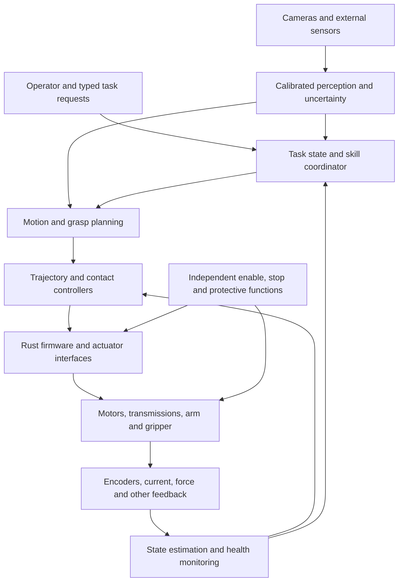

# Robotics: from hardware foundations to a workshop assistant

This is a knowledge-first atlas with **32 domains, 65 areas, and 204 focused study units**. Its integration target is a **DUM-E-inspired workshop robot**: a calibrated arm and gripper that can perceive a bounded workspace, move known objects, handle selected contact tasks, communicate its state, and recover from defined failures. Mobile manipulation and other embodiments form additional branches.

The fictional reference expresses the ambition. Actual capability is established through task requirements, load and error budgets, calibrated models, experiments, and the staged [build path](BUILD_PATH.md). This atlas reaches advanced control, perception, reinforcement learning, imitation learning, and sim-to-real transfer. A finite curriculum cannot exhaust robotics or guarantee open-world competence from completing a reading list.

Use the [complete topic index](TOPIC_INDEX.md) for every leaf unit and the [source catalog](SOURCES.md) for legitimate reading destinations. The [Mathematics atlas](../Mathematics/README.md), [CSE atlas](../Computer%20Science%20and%20Engineering/README.md), and [repository contribution rules](../AGENTS.md) support the prerequisites and future extensions.

## How to study

1. Choose a branch or build milestone. Read its prerequisite units before the dependent work; the whole-domain background table is a map, not a requirement to finish every earlier domain before beginning a simple experiment.
2. Read the selected section titles or chapter themes in `book_name.txt`. The `Primary book` label follows the repository format and can identify an explicitly labeled university text, official manual, standard preview, or original paper. Read the selected material rather than every recurring book in full.
3. Complete the six ordered objectives. Preserve definitions, diagrams, derivations, units, conventions, assumptions, counterexamples, and measured limitations alongside working models.
4. Finish the completion task. Keep data, calibration, code, hardware configuration, versions, and enough information to reproduce the experiment. Distinguish a simulated result from evidence about a physical robot.
5. Use `Extension book` entries for optional depth. A `Required second source` supplies precisely named material that the primary source does not cover.

Each leaf is a focused study unit, not a full semester course. Some completion tasks can begin entirely in simulation; physical commissioning adds measurements that cannot be replaced by simulated success. Numerical targets such as payload, reach, tracking error, cycle time, grip force, and allowable temperature come from the learner's specification and selected hardware documentation, rather than invented universal values.

## The robot architecture being learned

Learned models can support perception, state estimation, skill selection, residual control, or a carefully defined policy interface. Their outputs still pass through the tested action contracts, actuator limits, and protective architecture. Language interfaces propose bounded goals; user-interface responsiveness and language-model behavior do not establish servo timing or protective-function performance.

## Languages and tools

| Work | Primary languages and tools | Learning role |
| --- | --- | --- |
| Firmware and device boundaries | Rust, embedded-hal, RTIC where appropriate | Explicit ownership, bounded state, timing, fault handling, and communication. |
| Modeling, analysis, and autonomy | Python, NumPy, ROS 2 rclpy | Kinematics, dynamics, calibration, planning, estimation, and experiments. |
| Vision and learned policies | Python, PyTorch, OpenCV, YOLO | Geometric perception, learned visual models, deep RL, and imitation learning. |
| Data and experiments | Pandas, Polars, DuckDB, scikit-learn, MLflow as needed | Logged-data analysis and reproducible evaluation using the existing CSE stack. |
| Operator interfaces | TypeScript, React or Astro, HTML, CSS, Tailwind | Mode, telemetry, task requests, cancellation, and fault reporting. |
| Application boundaries | FastAPI, NestJS, or Axum as appropriate | Typed coordination and UI interfaces around robot software. |
| Physical design | FreeCAD, KiCad, calculation and measurement tools | Mechanical geometry, drawings, electronics, fabrication, and inspection. |
| Robotics infrastructure | ROS 2, ros2_control, MoveIt 2 | Messages, robot models, controller interfaces, planning scenes, and execution. |
| Simulation and control experiments | MuJoCo, Gazebo, or Drake Python interfaces | Choose tools for the experiment; learning every simulator is unnecessary before building the first model. |

**Python, TypeScript, and Rust remain the primary programming languages.** Robotics middleware and simulator internals often use native libraries. Use their supported interfaces and read enough of their notation to understand contracts. ROS 2 Rust clients are community-maintained integrations with their own supported versions and limitations; standard Python nodes plus a versioned Rust firmware bridge provide another explicit boundary. The Rust unit asks you to inspect compatibility rather than assume universal feature parity.

The catalog uses some fixed reference documentation, including ROS 2 Jazzy and Gazebo Harmonic. Select a coherent supported release combination and record the exact ROS, simulator, controller, Python, Rust, model, and firmware versions used. Mainline documentation is a conceptual guide, not proof that an API exists in a different installed release. Reinforcement-learning implementations use PyTorch; alternative ML frameworks are not required by this route.

## Prerequisite bridges

Start with arithmetic, algebra, basic programming, and file/tool use. Learn geometry, calculus, mechanics, and electrical ideas alongside small experiments. The mathematics prerequisites become deeper at kinematics, dynamics, estimation, optimization, and learning; their links are real continuation paths into the existing atlas.

| Foundation | Route | Why it matters |
| --- | --- | --- |
| Algebra and functions | [Algebra and functions](../Mathematics/03_Algebra_Functions) | Units, physical models, ratios, and actuator curves. |
| Trigonometry and complex numbers | [Trigonometry and complex numbers](../Mathematics/04_Precalculus) | Link geometry, rotations, oscillation, and frequency response. |
| Calculus | [Calculus](../Mathematics/06_Calculus) | Motion, derivatives, energy, gradients, and continuous dynamics. |
| Linear algebra | [Linear algebra](../Mathematics/07_Linear_Algebra) | Transforms, Jacobians, least squares, state-space models, and learning. |
| Differential equations | [Differential equations](../Mathematics/08_ODE_Dynamics) | Circuit transients, motor dynamics, vibration, and closed-loop behavior. |
| Probability and statistics | [Probability and statistics](../Mathematics/15_Probability_Statistics) | Sensor uncertainty, calibration, state estimation, and learning evaluation. |
| Optimization and control | [Optimization and control](../Mathematics/17_Optimization_Control) | IK, trajectory optimization, constrained control, and policy objectives. |
| Numerical computation | [Numerical computation](../Mathematics/18_Numerical_Computation) | Integration stability, solvers, conditioning, and derivative checks. |
| Python foundations | [Python foundations](../Computer%20Science%20and%20Engineering/01_Programming_Languages/01_Programming_foundations_in_Python) | Models, analysis, ROS rclpy nodes, and experiments. |
| Rust | [Rust](../Computer%20Science%20and%20Engineering/01_Programming_Languages/04_Rust) | Firmware, ownership, errors, concurrency, and device interfaces. |
| TypeScript | [TypeScript](../Computer%20Science%20and%20Engineering/01_Programming_Languages/03_TypeScript) | Typed operator interfaces and application boundaries. |
| Systems and concurrency | [Systems and concurrency](../Computer%20Science%20and%20Engineering/16_Concurrency_and_Parallelism) | Timing, shared state, channels, backpressure, and task shutdown. |
| Networks | [Networks](../Computer%20Science%20and%20Engineering/09_Computer_Networks) | Robot communication, delays, framing, and partial failure. |
| Testing and formal methods | [Testing and formal methods](../Computer%20Science%20and%20Engineering/15_Testing_and_Formal_Methods) | Properties, state invariants, fault injection, and model scope. |
| Current data stack | [Current data stack](../Computer%20Science%20and%20Engineering/23_Data_Science_and_Data_Engineering) | NumPy models and Pandas, Polars, and DuckDB robot logs. |
| Statistical learning | [Statistical learning](../Computer%20Science%20and%20Engineering/25_Machine_Learning) | Generalization, evaluation, calibration, and baselines. |
| PyTorch | [PyTorch](../Computer%20Science%20and%20Engineering/26_Deep_Learning_with_PyTorch/01_Tensors_autograd_and_training) | Autograd, neural models, datasets, and optimization before deep RL. |
| Vision and YOLO | [Vision and YOLO](../Computer%20Science%20and%20Engineering/28_Graphics_and_Computer_Vision) | Image geometry, neural detection, and deployment basics. |
| LangGraph | [LangGraph](../Computer%20Science%20and%20Engineering/27_Language_Models_and_Agent_Systems/04_LangGraph_state_and_control) | Optional bounded high-level workflows and human review. |
| Application frameworks | [Application frameworks](../Computer%20Science%20and%20Engineering/21_Web_and_Application_Engineering) | FastAPI, NestJS, Axum, React, Astro, and Tailwind interfaces. |
| Security engineering | [Security engineering](../Computer%20Science%20and%20Engineering/20_Security_and_Cryptography/01_Security_models_and_implementation) | Remote command authority, update integrity, and recorded-data protection. |

For a first static load calculation, algebra, vectors, and equilibrium are sufficient. Dynamics and continuous control require calculus and differential equations. Estimation and learning require probability, linear algebra, and numerical reasoning. Before deep RL, finish the PyTorch tensor, autograd, training-loop, and evaluation foundations. Before remote control and update work, study the linked security concepts. A software or mathematics gap should lead to a prerequisite unit, rather than an unexplained assumption.

## Entry routes and branching points

- **Hardware and fabrication:** [00 Robot goals, engineering practice, and laboratory foundations](00_Robot_Goals_and_Engineering_Practice) → [01 Mathematics and physical modeling for robots](01_Mathematics_and_Physics_Bridges) → [02 Structural mechanics and material selection](02_Structures_and_Materials) → [03 Mechanisms, joints, and transmissions](03_Mechanisms_and_Machine_Elements) → [04 CAD, fabrication, assembly, and dimensional metrology](04_CAD_Fabrication_and_Metrology) → [05 Circuits, electronics, and controller-board foundations](05_Circuits_Electronics_and_PCBs) → [06 Actuators, motors, and drive systems](06_Actuators_Motors_and_Drives) → [07 Power distribution, stored energy, and thermal design](07_Power_Distribution_and_Thermal_Design) → [08 Robot sensing and instrumentation](08_Sensors_and_Instrumentation) → [09 Embedded Rust and real-time execution](09_Embedded_Rust_and_Real_Time_Control). Make load paths, measurements, actuator limits, and fault states explicit.
- **Arm mathematics and control:** [10 Rigid geometry and coordinate frames](10_Rigid_Geometry_and_Coordinate_Frames) → [11 Arm kinematics and workspace analysis](11_Arm_Kinematics_and_Workspaces) → [12 Robot dynamics and physical contact models](12_Robot_Dynamics_and_Contact_Models) → [13 Feedback, servo control, and motion tracking](13_Feedback_and_Motion_Control) → [14 State estimation and sensor fusion](14_State_Estimation_and_Sensor_Fusion) → [15 Calibration and system identification](15_Calibration_and_System_Identification). Derive models and validate them with simulation or measurements.
- **Robot software and simulation:** [16 Robot software architecture and ROS 2](16_Robot_Software_and_ROS2) → [17 Simulation and digital twins](17_Simulation_and_Digital_Twins). Bring the relevant geometry, control, and firmware foundations before hardware integration.
- **Motion and manipulation:** [18 Motion planning and trajectory optimization](18_Motion_Planning_and_Trajectory_Optimization) → [19 Grasping and contact-rich manipulation](19_Grasping_and_Contact_Manipulation). Start with known geometry and deterministic tasks, then add uncertainty and perception.
- **Vision-guided interaction:** [20 Computer vision and geometric perception](20_Computer_Vision_and_3D_Perception) → [21 Learned perception with PyTorch and YOLO](21_Learned_Perception_and_Visuomotor_Representations) → [23 Task autonomy and human-robot interaction](23_Task_Autonomy_and_Human_Robot_Interaction). Connect calibrated geometry, learned perception, verified skills, and an operator interface.
- **Learning to act:** [24 Reinforcement learning foundations for robot tasks](24_Reinforcement_Learning_Foundations) → [25 Deep reinforcement learning with PyTorch](25_Deep_Reinforcement_Learning_with_PyTorch) → [26 Imitation learning, offline data, and sim-to-real transfer](26_Imitation_Learning_and_Sim_to_Real) → [27 Advanced control and learning-based manipulation](27_Advanced_Control_and_Learning_Based_Manipulation). Build simulator contracts, baselines, evaluation, and runtime limits before transfer experiments.
- **Mobile and alternative embodiments:** [22 Localization, mapping, and mobile navigation](22_Localization_Mapping_and_Navigation) → [28 Additional embodiments and actuation branches](28_Mobile_Legged_Aerial_and_Soft_Robotics). Optional extensions for mobile bases, legs, flight, soft hands, fluid actuators, and multiple robots.
- **Reliability, integration, and research:** [29 Reliability, safety engineering, and system validation](29_Robustness_Safety_and_System_Validation) → [30 Workshop-assistant integration projects](30_Workshop_Assistant_Integration_Projects) → [31 Research practice and advanced robotics directions](31_Research_and_Advanced_Frontiers). Return to fault analysis throughout the work; use the build milestones to assemble capabilities incrementally.

The [build path](BUILD_PATH.md) selects exact units for the workshop-assistant target. The optional locomotion and research branches do not gate the first arm, and a learned policy is not a prerequisite for calibrated pick-and-place. Early integration projects can be revisited at increasing fidelity as their specific prerequisites are completed.

## Domain map

The listed background supports the full branch; the topic index and build milestones identify narrower entry points. Extra mathematics comes from the bridges above. Every dependency points to an earlier numbered domain, and the later continuations below explain where the material is reused.

| Order | Domain | Background for the branch | Role |
| --- | --- | --- | --- |
| 00 | [Robot goals, engineering practice, and laboratory foundations](00_Robot_Goals_and_Engineering_Practice) | none | Turn a workshop-assistant idea into measurable capabilities, interfaces, experiments, and a staged build. |
| 01 | [Mathematics and physical modeling for robots](01_Mathematics_and_Physics_Bridges) | [00 Robot goals, engineering practice, and laboratory foundations](00_Robot_Goals_and_Engineering_Practice) | Connect the Mathematics atlas to forces, motion, uncertainty, and numerical models used in robot design. |
| 02 | [Structural mechanics and material selection](02_Structures_and_Materials) | [01 Mathematics and physical modeling for robots](01_Mathematics_and_Physics_Bridges) | Calculate whether links, mounts, and joints remain strong and stiff under realistic loads. |
| 03 | [Mechanisms, joints, and transmissions](03_Mechanisms_and_Machine_Elements) | [02 Structural mechanics and material selection](02_Structures_and_Materials) | Design the physical motion chain and understand friction, backlash, alignment, and transmission tradeoffs. |
| 04 | [CAD, fabrication, assembly, and dimensional metrology](04_CAD_Fabrication_and_Metrology) | [02 Structural mechanics and material selection](02_Structures_and_Materials), [03 Mechanisms, joints, and transmissions](03_Mechanisms_and_Machine_Elements) | Turn calculations into buildable parts, toleranced interfaces, and inspectable assemblies. |
| 05 | [Circuits, electronics, and controller-board foundations](05_Circuits_Electronics_and_PCBs) | [01 Mathematics and physical modeling for robots](01_Mathematics_and_Physics_Bridges) | Understand signal and power paths before connecting sensors and motor drives. |
| 06 | [Actuators, motors, and drive systems](06_Actuators_Motors_and_Drives) | [03 Mechanisms, joints, and transmissions](03_Mechanisms_and_Machine_Elements), [05 Circuits, electronics, and controller-board foundations](05_Circuits_Electronics_and_PCBs) | Match actuator physics and drive behavior to torque, speed, precision, and duty-cycle requirements. |
| 07 | [Power distribution, stored energy, and thermal design](07_Power_Distribution_and_Thermal_Design) | [05 Circuits, electronics, and controller-board foundations](05_Circuits_Electronics_and_PCBs), [06 Actuators, motors, and drive systems](06_Actuators_Motors_and_Drives) | Budget electrical and thermal loads and define controlled startup, shutdown, and fault behavior. |
| 08 | [Robot sensing and instrumentation](08_Sensors_and_Instrumentation) | [05 Circuits, electronics, and controller-board foundations](05_Circuits_Electronics_and_PCBs), [07 Power distribution, stored energy, and thermal design](07_Power_Distribution_and_Thermal_Design) | Choose sensors from observability, accuracy, bandwidth, mounting, and environmental requirements. |
| 09 | [Embedded Rust and real-time execution](09_Embedded_Rust_and_Real_Time_Control) | [05 Circuits, electronics, and controller-board foundations](05_Circuits_Electronics_and_PCBs), [06 Actuators, motors, and drive systems](06_Actuators_Motors_and_Drives), [08 Robot sensing and instrumentation](08_Sensors_and_Instrumentation) | Build bounded, observable firmware that turns measurements and commands into reliable actuator behavior. |
| 10 | [Rigid geometry and coordinate frames](10_Rigid_Geometry_and_Coordinate_Frames) | [01 Mathematics and physical modeling for robots](01_Mathematics_and_Physics_Bridges) | Represent where bodies and sensors are, how they move, and how forces transform. |
| 11 | [Arm kinematics and workspace analysis](11_Arm_Kinematics_and_Workspaces) | [03 Mechanisms, joints, and transmissions](03_Mechanisms_and_Machine_Elements), [10 Rigid geometry and coordinate frames](10_Rigid_Geometry_and_Coordinate_Frames) | Map joint coordinates to end-effector motion and understand redundancy, singularities, and physical limits. |
| 12 | [Robot dynamics and physical contact models](12_Robot_Dynamics_and_Contact_Models) | [01 Mathematics and physical modeling for robots](01_Mathematics_and_Physics_Bridges), [06 Actuators, motors, and drive systems](06_Actuators_Motors_and_Drives), [10 Rigid geometry and coordinate frames](10_Rigid_Geometry_and_Coordinate_Frames), [11 Arm kinematics and workspace analysis](11_Arm_Kinematics_and_Workspaces) | Predict joint torques and contact forces from mass, motion, transmission, and environment models. |
| 13 | [Feedback, servo control, and motion tracking](13_Feedback_and_Motion_Control) | [06 Actuators, motors, and drive systems](06_Actuators_Motors_and_Drives), [09 Embedded Rust and real-time execution](09_Embedded_Rust_and_Real_Time_Control), [11 Arm kinematics and workspace analysis](11_Arm_Kinematics_and_Workspaces), [12 Robot dynamics and physical contact models](12_Robot_Dynamics_and_Contact_Models) | Control motion while accounting for stability, sensing, saturation, latency, and disturbances. |
| 14 | [State estimation and sensor fusion](14_State_Estimation_and_Sensor_Fusion) | [08 Robot sensing and instrumentation](08_Sensors_and_Instrumentation), [10 Rigid geometry and coordinate frames](10_Rigid_Geometry_and_Coordinate_Frames), [12 Robot dynamics and physical contact models](12_Robot_Dynamics_and_Contact_Models) | Infer robot state from noisy, delayed, incomplete measurements and inspect uncertainty claims. |
| 15 | [Calibration and system identification](15_Calibration_and_System_Identification) | [04 CAD, fabrication, assembly, and dimensional metrology](04_CAD_Fabrication_and_Metrology), [08 Robot sensing and instrumentation](08_Sensors_and_Instrumentation), [11 Arm kinematics and workspace analysis](11_Arm_Kinematics_and_Workspaces), [12 Robot dynamics and physical contact models](12_Robot_Dynamics_and_Contact_Models), [14 State estimation and sensor fusion](14_State_Estimation_and_Sensor_Fusion) | Measure the actual robot rather than relying on nominal geometry, datasheets, or simulator defaults. |
| 16 | [Robot software architecture and ROS 2](16_Robot_Software_and_ROS2) | [09 Embedded Rust and real-time execution](09_Embedded_Rust_and_Real_Time_Control), [10 Rigid geometry and coordinate frames](10_Rigid_Geometry_and_Coordinate_Frames), [11 Arm kinematics and workspace analysis](11_Arm_Kinematics_and_Workspaces), [13 Feedback, servo control, and motion tracking](13_Feedback_and_Motion_Control), [14 State estimation and sensor fusion](14_State_Estimation_and_Sensor_Fusion) | Integrate firmware, Python autonomy, robot models, and operator interfaces through explicit timing and state contracts. |
| 17 | [Simulation and digital twins](17_Simulation_and_Digital_Twins) | [11 Arm kinematics and workspace analysis](11_Arm_Kinematics_and_Workspaces), [12 Robot dynamics and physical contact models](12_Robot_Dynamics_and_Contact_Models), [13 Feedback, servo control, and motion tracking](13_Feedback_and_Motion_Control), [15 Calibration and system identification](15_Calibration_and_System_Identification), [16 Robot software architecture and ROS 2](16_Robot_Software_and_ROS2) | Use physics and software simulation as testable models with explicit reality gaps. |
| 18 | [Motion planning and trajectory optimization](18_Motion_Planning_and_Trajectory_Optimization) | [11 Arm kinematics and workspace analysis](11_Arm_Kinematics_and_Workspaces), [12 Robot dynamics and physical contact models](12_Robot_Dynamics_and_Contact_Models), [13 Feedback, servo control, and motion tracking](13_Feedback_and_Motion_Control), [17 Simulation and digital twins](17_Simulation_and_Digital_Twins) | Find feasible motions and validate them against geometry, actuation, uncertainty, and execution constraints. |
| 19 | [Grasping and contact-rich manipulation](19_Grasping_and_Contact_Manipulation) | [03 Mechanisms, joints, and transmissions](03_Mechanisms_and_Machine_Elements), [08 Robot sensing and instrumentation](08_Sensors_and_Instrumentation), [12 Robot dynamics and physical contact models](12_Robot_Dynamics_and_Contact_Models), [13 Feedback, servo control, and motion tracking](13_Feedback_and_Motion_Control), [18 Motion planning and trajectory optimization](18_Motion_Planning_and_Trajectory_Optimization) | Make the arm interact with objects through modeled contact, grasp geometry, sensing, and recovery. |
| 20 | [Computer vision and geometric perception](20_Computer_Vision_and_3D_Perception) | [08 Robot sensing and instrumentation](08_Sensors_and_Instrumentation), [10 Rigid geometry and coordinate frames](10_Rigid_Geometry_and_Coordinate_Frames), [14 State estimation and sensor fusion](14_State_Estimation_and_Sensor_Fusion), [15 Calibration and system identification](15_Calibration_and_System_Identification), [17 Simulation and digital twins](17_Simulation_and_Digital_Twins) | Turn images and range measurements into calibrated geometry with observable error and ambiguity. |
| 21 | [Learned perception with PyTorch and YOLO](21_Learned_Perception_and_Visuomotor_Representations) | [19 Grasping and contact-rich manipulation](19_Grasping_and_Contact_Manipulation), [20 Computer vision and geometric perception](20_Computer_Vision_and_3D_Perception) | Connect the current learning stack to measured robot-frame geometry and task-level perception requirements. |
| 22 | [Localization, mapping, and mobile navigation](22_Localization_Mapping_and_Navigation) | [14 State estimation and sensor fusion](14_State_Estimation_and_Sensor_Fusion), [17 Simulation and digital twins](17_Simulation_and_Digital_Twins), [18 Motion planning and trajectory optimization](18_Motion_Planning_and_Trajectory_Optimization), [20 Computer vision and geometric perception](20_Computer_Vision_and_3D_Perception) | Extend the workshop arm toward a mobile manipulator that knows where it is and moves through uncertain environments. |
| 23 | [Task autonomy and human-robot interaction](23_Task_Autonomy_and_Human_Robot_Interaction) | [16 Robot software architecture and ROS 2](16_Robot_Software_and_ROS2), [18 Motion planning and trajectory optimization](18_Motion_Planning_and_Trajectory_Optimization), [19 Grasping and contact-rich manipulation](19_Grasping_and_Contact_Manipulation), [21 Learned perception with PyTorch and YOLO](21_Learned_Perception_and_Visuomotor_Representations) | Compose reliable skills, communicate intent, and give people clear authority over a bounded autonomous system. |
| 24 | [Reinforcement learning foundations for robot tasks](24_Reinforcement_Learning_Foundations) | [01 Mathematics and physical modeling for robots](01_Mathematics_and_Physics_Bridges), [13 Feedback, servo control, and motion tracking](13_Feedback_and_Motion_Control), [17 Simulation and digital twins](17_Simulation_and_Digital_Twins), [23 Task autonomy and human-robot interaction](23_Task_Autonomy_and_Human_Robot_Interaction) | Understand sequential learning mathematically before training neural controllers or transferring policies to hardware. |
| 25 | [Deep reinforcement learning with PyTorch](25_Deep_Reinforcement_Learning_with_PyTorch) | [21 Learned perception with PyTorch and YOLO](21_Learned_Perception_and_Visuomotor_Representations), [24 Reinforcement learning foundations for robot tasks](24_Reinforcement_Learning_Foundations) | Implement and diagnose neural policies, critics, and reproducible robot-learning experiments. |
| 26 | [Imitation learning, offline data, and sim-to-real transfer](26_Imitation_Learning_and_Sim_to_Real) | [15 Calibration and system identification](15_Calibration_and_System_Identification), [17 Simulation and digital twins](17_Simulation_and_Digital_Twins), [19 Grasping and contact-rich manipulation](19_Grasping_and_Contact_Manipulation), [21 Learned perception with PyTorch and YOLO](21_Learned_Perception_and_Visuomotor_Representations), [25 Deep reinforcement learning with PyTorch](25_Deep_Reinforcement_Learning_with_PyTorch) | Learn from demonstrations and simulated experience while measuring distribution shift and deployment limits. |
| 27 | [Advanced control and learning-based manipulation](27_Advanced_Control_and_Learning_Based_Manipulation) | [13 Feedback, servo control, and motion tracking](13_Feedback_and_Motion_Control), [14 State estimation and sensor fusion](14_State_Estimation_and_Sensor_Fusion), [18 Motion planning and trajectory optimization](18_Motion_Planning_and_Trajectory_Optimization), [19 Grasping and contact-rich manipulation](19_Grasping_and_Contact_Manipulation), [26 Imitation learning, offline data, and sim-to-real transfer](26_Imitation_Learning_and_Sim_to_Real) | Deepen optimization, stability reasoning, model learning, and dexterous contact without losing explicit control assumptions. |
| 28 | [Additional embodiments and actuation branches](28_Mobile_Legged_Aerial_and_Soft_Robotics) | [03 Mechanisms, joints, and transmissions](03_Mechanisms_and_Machine_Elements), [06 Actuators, motors, and drive systems](06_Actuators_Motors_and_Drives), [12 Robot dynamics and physical contact models](12_Robot_Dynamics_and_Contact_Models), [13 Feedback, servo control, and motion tracking](13_Feedback_and_Motion_Control), [17 Simulation and digital twins](17_Simulation_and_Digital_Twins), [22 Localization, mapping, and mobile navigation](22_Localization_Mapping_and_Navigation) | Extend the common foundations into other robot bodies while keeping the workshop arm as the main integration target. |
| 29 | [Reliability, safety engineering, and system validation](29_Robustness_Safety_and_System_Validation) | [00 Robot goals, engineering practice, and laboratory foundations](00_Robot_Goals_and_Engineering_Practice), [07 Power distribution, stored energy, and thermal design](07_Power_Distribution_and_Thermal_Design), [09 Embedded Rust and real-time execution](09_Embedded_Rust_and_Real_Time_Control), [13 Feedback, servo control, and motion tracking](13_Feedback_and_Motion_Control), [15 Calibration and system identification](15_Calibration_and_System_Identification), [16 Robot software architecture and ROS 2](16_Robot_Software_and_ROS2), [18 Motion planning and trajectory optimization](18_Motion_Planning_and_Trajectory_Optimization), [23 Task autonomy and human-robot interaction](23_Task_Autonomy_and_Human_Robot_Interaction), [27 Advanced control and learning-based manipulation](27_Advanced_Control_and_Learning_Based_Manipulation) | Build an evidence-based case for behavior under faults, uncertainty, wear, and human interaction. |
| 30 | [Workshop-assistant integration projects](30_Workshop_Assistant_Integration_Projects) | [04 CAD, fabrication, assembly, and dimensional metrology](04_CAD_Fabrication_and_Metrology), [06 Actuators, motors, and drive systems](06_Actuators_Motors_and_Drives), [07 Power distribution, stored energy, and thermal design](07_Power_Distribution_and_Thermal_Design), [09 Embedded Rust and real-time execution](09_Embedded_Rust_and_Real_Time_Control), [11 Arm kinematics and workspace analysis](11_Arm_Kinematics_and_Workspaces), [13 Feedback, servo control, and motion tracking](13_Feedback_and_Motion_Control), [15 Calibration and system identification](15_Calibration_and_System_Identification), [16 Robot software architecture and ROS 2](16_Robot_Software_and_ROS2), [17 Simulation and digital twins](17_Simulation_and_Digital_Twins), [18 Motion planning and trajectory optimization](18_Motion_Planning_and_Trajectory_Optimization), [19 Grasping and contact-rich manipulation](19_Grasping_and_Contact_Manipulation), [20 Computer vision and geometric perception](20_Computer_Vision_and_3D_Perception), [21 Learned perception with PyTorch and YOLO](21_Learned_Perception_and_Visuomotor_Representations), [23 Task autonomy and human-robot interaction](23_Task_Autonomy_and_Human_Robot_Interaction), [29 Reliability, safety engineering, and system validation](29_Robustness_Safety_and_System_Validation) | Demonstrate the capabilities of a DUM-E-inspired robot through staged, reviewable integration projects. |
| 31 | [Research practice and advanced robotics directions](31_Research_and_Advanced_Frontiers) | [24 Reinforcement learning foundations for robot tasks](24_Reinforcement_Learning_Foundations), [25 Deep reinforcement learning with PyTorch](25_Deep_Reinforcement_Learning_with_PyTorch), [26 Imitation learning, offline data, and sim-to-real transfer](26_Imitation_Learning_and_Sim_to_Real), [27 Advanced control and learning-based manipulation](27_Advanced_Control_and_Learning_Based_Manipulation), [30 Workshop-assistant integration projects](30_Workshop_Assistant_Integration_Projects) | Read and reproduce research while distinguishing promising directions from demonstrated robot capabilities. |

## Areas and continuations

### 00. Robot goals, engineering practice, and laboratory foundations

Turn a workshop-assistant idea into measurable capabilities, interfaces, experiments, and a staged build.

- [Robot requirements and system decomposition](00_Robot_Goals_and_Engineering_Practice/01_Requirements_and_systems) (3 units).
- [Measurements, hazards, and staged experiments](00_Robot_Goals_and_Engineering_Practice/02_Laboratory_foundations) (3 units).

Continues into: [01 Mathematics and physical modeling for robots](01_Mathematics_and_Physics_Bridges), [29 Reliability, safety engineering, and system validation](29_Robustness_Safety_and_System_Validation).

### 01. Mathematics and physical modeling for robots

Connect the Mathematics atlas to forces, motion, uncertainty, and numerical models used in robot design.

- [Vectors, derivatives, probability, and numerical reasoning](01_Mathematics_and_Physics_Bridges/01_Mathematical_tools) (3 units).
- [Motion, force, energy, and oscillation](01_Mathematics_and_Physics_Bridges/02_Physical_models) (3 units).

Continues into: [02 Structural mechanics and material selection](02_Structures_and_Materials), [05 Circuits, electronics, and controller-board foundations](05_Circuits_Electronics_and_PCBs), [10 Rigid geometry and coordinate frames](10_Rigid_Geometry_and_Coordinate_Frames), [12 Robot dynamics and physical contact models](12_Robot_Dynamics_and_Contact_Models), [24 Reinforcement learning foundations for robot tasks](24_Reinforcement_Learning_Foundations).

### 02. Structural mechanics and material selection

Calculate whether links, mounts, and joints remain strong and stiff under realistic loads.

- [Equilibrium, stress, and stiffness](02_Structures_and_Materials/01_Loads_stress_and_deflection) (3 units).
- [Failure mechanisms and realistic design margins](02_Structures_and_Materials/02_Failure_and_material_tradeoffs) (3 units).

Continues into: [03 Mechanisms, joints, and transmissions](03_Mechanisms_and_Machine_Elements), [04 CAD, fabrication, assembly, and dimensional metrology](04_CAD_Fabrication_and_Metrology).

### 03. Mechanisms, joints, and transmissions

Design the physical motion chain and understand friction, backlash, alignment, and transmission tradeoffs.

- [Joints, bearings, shafts, and fasteners](03_Mechanisms_and_Machine_Elements/01_Joints_and_constraint_design) (3 units).
- [Gears, flexible drives, screws, and balancing](03_Mechanisms_and_Machine_Elements/02_Transmission_design) (3 units).

Continues into: [04 CAD, fabrication, assembly, and dimensional metrology](04_CAD_Fabrication_and_Metrology), [06 Actuators, motors, and drive systems](06_Actuators_Motors_and_Drives), [11 Arm kinematics and workspace analysis](11_Arm_Kinematics_and_Workspaces), [19 Grasping and contact-rich manipulation](19_Grasping_and_Contact_Manipulation), [28 Additional embodiments and actuation branches](28_Mobile_Legged_Aerial_and_Soft_Robotics).

### 04. CAD, fabrication, assembly, and dimensional metrology

Turn calculations into buildable parts, toleranced interfaces, and inspectable assemblies.

- [CAD models and manufacturing intent](04_CAD_Fabrication_and_Metrology/01_Parametric_design_and_drawings) (3 units).
- [Manufacturing choices and measured assembly quality](04_CAD_Fabrication_and_Metrology/02_Fabrication_and_inspection) (4 units).

Continues into: [15 Calibration and system identification](15_Calibration_and_System_Identification), [30 Workshop-assistant integration projects](30_Workshop_Assistant_Integration_Projects).

### 05. Circuits, electronics, and controller-board foundations

Understand signal and power paths before connecting sensors and motor drives.

- [Circuits, transients, and analog interfaces](05_Circuits_Electronics_and_PCBs/01_Circuit_and_signal_foundations) (3 units).
- [Switches, digital boundaries, and PCB practice](05_Circuits_Electronics_and_PCBs/02_Switching_digital_interfaces_and_boards) (4 units).

Continues into: [06 Actuators, motors, and drive systems](06_Actuators_Motors_and_Drives), [07 Power distribution, stored energy, and thermal design](07_Power_Distribution_and_Thermal_Design), [08 Robot sensing and instrumentation](08_Sensors_and_Instrumentation), [09 Embedded Rust and real-time execution](09_Embedded_Rust_and_Real_Time_Control).

### 06. Actuators, motors, and drive systems

Match actuator physics and drive behavior to torque, speed, precision, and duty-cycle requirements.

- [Motor physics and sizing](06_Actuators_Motors_and_Drives/01_Motor_models_and_selection) (3 units).
- [Commutation, current control, and actuator alternatives](06_Actuators_Motors_and_Drives/02_Drive_control_and_alternative_actuation) (3 units).

Continues into: [07 Power distribution, stored energy, and thermal design](07_Power_Distribution_and_Thermal_Design), [09 Embedded Rust and real-time execution](09_Embedded_Rust_and_Real_Time_Control), [12 Robot dynamics and physical contact models](12_Robot_Dynamics_and_Contact_Models), [13 Feedback, servo control, and motion tracking](13_Feedback_and_Motion_Control), [28 Additional embodiments and actuation branches](28_Mobile_Legged_Aerial_and_Soft_Robotics), [30 Workshop-assistant integration projects](30_Workshop_Assistant_Integration_Projects).

### 07. Power distribution, stored energy, and thermal design

Budget electrical and thermal loads and define controlled startup, shutdown, and fault behavior.

- [Supply sizing and electrical protection](07_Power_Distribution_and_Thermal_Design/01_Power_architecture) (3 units).
- [Energy storage and thermal behavior](07_Power_Distribution_and_Thermal_Design/02_Energy_and_heat) (3 units).

Continues into: [08 Robot sensing and instrumentation](08_Sensors_and_Instrumentation), [29 Reliability, safety engineering, and system validation](29_Robustness_Safety_and_System_Validation), [30 Workshop-assistant integration projects](30_Workshop_Assistant_Integration_Projects).

### 08. Robot sensing and instrumentation

Choose sensors from observability, accuracy, bandwidth, mounting, and environmental requirements.

- [Joint position, current, force, and motion sensing](08_Sensors_and_Instrumentation/01_Internal_robot_sensing) (3 units).
- [Cameras, range sensors, touch, and acquisition](08_Sensors_and_Instrumentation/02_External_and_contact_sensing) (3 units).

Continues into: [09 Embedded Rust and real-time execution](09_Embedded_Rust_and_Real_Time_Control), [14 State estimation and sensor fusion](14_State_Estimation_and_Sensor_Fusion), [15 Calibration and system identification](15_Calibration_and_System_Identification), [19 Grasping and contact-rich manipulation](19_Grasping_and_Contact_Manipulation), [20 Computer vision and geometric perception](20_Computer_Vision_and_3D_Perception).

### 09. Embedded Rust and real-time execution

Build bounded, observable firmware that turns measurements and commands into reliable actuator behavior.

- [Rust firmware and portable device drivers](09_Embedded_Rust_and_Real_Time_Control/01_Firmware_and_peripheral_interfaces) (3 units).
- [Timing, watchdogs, and embedded networking](09_Embedded_Rust_and_Real_Time_Control/02_Deterministic_loops_and_communication) (4 units).

Continues into: [13 Feedback, servo control, and motion tracking](13_Feedback_and_Motion_Control), [16 Robot software architecture and ROS 2](16_Robot_Software_and_ROS2), [29 Reliability, safety engineering, and system validation](29_Robustness_Safety_and_System_Validation), [30 Workshop-assistant integration projects](30_Workshop_Assistant_Integration_Projects).

### 10. Rigid geometry and coordinate frames

Represent where bodies and sensors are, how they move, and how forces transform.

- [Rotations, poses, and frame conventions](10_Rigid_Geometry_and_Coordinate_Frames/01_Rotations_and_transforms) (3 units).
- [Twists, wrenches, and spatial uncertainty](10_Rigid_Geometry_and_Coordinate_Frames/02_Spatial_velocity_and_force) (2 units).

Continues into: [11 Arm kinematics and workspace analysis](11_Arm_Kinematics_and_Workspaces), [12 Robot dynamics and physical contact models](12_Robot_Dynamics_and_Contact_Models), [14 State estimation and sensor fusion](14_State_Estimation_and_Sensor_Fusion), [16 Robot software architecture and ROS 2](16_Robot_Software_and_ROS2), [20 Computer vision and geometric perception](20_Computer_Vision_and_3D_Perception).

### 11. Arm kinematics and workspace analysis

Map joint coordinates to end-effector motion and understand redundancy, singularities, and physical limits.

- [Robot descriptions and pose solutions](11_Arm_Kinematics_and_Workspaces/01_Forward_and_inverse_kinematics) (3 units).
- [Jacobians, singularities, and null spaces](11_Arm_Kinematics_and_Workspaces/02_Differential_motion_and_redundancy) (3 units).

Continues into: [12 Robot dynamics and physical contact models](12_Robot_Dynamics_and_Contact_Models), [13 Feedback, servo control, and motion tracking](13_Feedback_and_Motion_Control), [15 Calibration and system identification](15_Calibration_and_System_Identification), [16 Robot software architecture and ROS 2](16_Robot_Software_and_ROS2), [17 Simulation and digital twins](17_Simulation_and_Digital_Twins), [18 Motion planning and trajectory optimization](18_Motion_Planning_and_Trajectory_Optimization), [30 Workshop-assistant integration projects](30_Workshop_Assistant_Integration_Projects).

### 12. Robot dynamics and physical contact models

Predict joint torques and contact forces from mass, motion, transmission, and environment models.

- [Mass properties and equations of motion](12_Robot_Dynamics_and_Contact_Models/01_Rigid_body_dynamics) (3 units).
- [Friction, compliance, and contact](12_Robot_Dynamics_and_Contact_Models/02_Nonideal_transmissions_and_contact) (3 units).

Continues into: [13 Feedback, servo control, and motion tracking](13_Feedback_and_Motion_Control), [14 State estimation and sensor fusion](14_State_Estimation_and_Sensor_Fusion), [15 Calibration and system identification](15_Calibration_and_System_Identification), [17 Simulation and digital twins](17_Simulation_and_Digital_Twins), [18 Motion planning and trajectory optimization](18_Motion_Planning_and_Trajectory_Optimization), [19 Grasping and contact-rich manipulation](19_Grasping_and_Contact_Manipulation), [28 Additional embodiments and actuation branches](28_Mobile_Legged_Aerial_and_Soft_Robotics).

### 13. Feedback, servo control, and motion tracking

Control motion while accounting for stability, sensing, saturation, latency, and disturbances.

- [Models, stability, PID, and loop shaping](13_Feedback_and_Motion_Control/01_Feedback_and_linear_control) (3 units).
- [Nested loops and robot-specific tracking](13_Feedback_and_Motion_Control/02_Robot_servo_architectures) (3 units).
- [Task-space and force-aware control](13_Feedback_and_Motion_Control/03_Contact_aware_control) (2 units).

Continues into: [16 Robot software architecture and ROS 2](16_Robot_Software_and_ROS2), [17 Simulation and digital twins](17_Simulation_and_Digital_Twins), [18 Motion planning and trajectory optimization](18_Motion_Planning_and_Trajectory_Optimization), [19 Grasping and contact-rich manipulation](19_Grasping_and_Contact_Manipulation), [24 Reinforcement learning foundations for robot tasks](24_Reinforcement_Learning_Foundations), [27 Advanced control and learning-based manipulation](27_Advanced_Control_and_Learning_Based_Manipulation), [28 Additional embodiments and actuation branches](28_Mobile_Legged_Aerial_and_Soft_Robotics), [29 Reliability, safety engineering, and system validation](29_Robustness_Safety_and_System_Validation), [30 Workshop-assistant integration projects](30_Workshop_Assistant_Integration_Projects).

### 14. State estimation and sensor fusion

Infer robot state from noisy, delayed, incomplete measurements and inspect uncertainty claims.

- [Bayes filtering and local linearization](14_State_Estimation_and_Sensor_Fusion/01_Probabilistic_filters) (3 units).
- [Inertial fusion, factor graphs, and timing](14_State_Estimation_and_Sensor_Fusion/02_Multisensor_and_batch_estimation) (4 units).

Continues into: [15 Calibration and system identification](15_Calibration_and_System_Identification), [16 Robot software architecture and ROS 2](16_Robot_Software_and_ROS2), [20 Computer vision and geometric perception](20_Computer_Vision_and_3D_Perception), [22 Localization, mapping, and mobile navigation](22_Localization_Mapping_and_Navigation), [27 Advanced control and learning-based manipulation](27_Advanced_Control_and_Learning_Based_Manipulation).

### 15. Calibration and system identification

Measure the actual robot rather than relying on nominal geometry, datasheets, or simulator defaults.

- [Joint, camera, and tool calibration](15_Calibration_and_System_Identification/01_Geometric_and_sensor_calibration) (3 units).
- [Model fitting and validation](15_Calibration_and_System_Identification/02_Dynamic_identification_and_error_budgets) (3 units).

Continues into: [17 Simulation and digital twins](17_Simulation_and_Digital_Twins), [20 Computer vision and geometric perception](20_Computer_Vision_and_3D_Perception), [26 Imitation learning, offline data, and sim-to-real transfer](26_Imitation_Learning_and_Sim_to_Real), [29 Reliability, safety engineering, and system validation](29_Robustness_Safety_and_System_Validation), [30 Workshop-assistant integration projects](30_Workshop_Assistant_Integration_Projects).

### 16. Robot software architecture and ROS 2

Integrate firmware, Python autonomy, robot models, and operator interfaces through explicit timing and state contracts.

- [Nodes, interfaces, transforms, and descriptions](16_Robot_Software_and_ROS2/01_ROS_communication_and_robot_models) (3 units).
- [Control integration and system lifecycle](16_Robot_Software_and_ROS2/02_Hardware_control_and_lifecycle) (4 units).

Continues into: [17 Simulation and digital twins](17_Simulation_and_Digital_Twins), [23 Task autonomy and human-robot interaction](23_Task_Autonomy_and_Human_Robot_Interaction), [29 Reliability, safety engineering, and system validation](29_Robustness_Safety_and_System_Validation), [30 Workshop-assistant integration projects](30_Workshop_Assistant_Integration_Projects).

### 17. Simulation and digital twins

Use physics and software simulation as testable models with explicit reality gaps.

- [Models, physics, and sensor simulation](17_Simulation_and_Digital_Twins/01_Robot_models_and_simulators) (3 units).
- [Drake, fidelity, and hardware interfaces](17_Simulation_and_Digital_Twins/02_Model_based_experiments_and_validation) (3 units).

Continues into: [18 Motion planning and trajectory optimization](18_Motion_Planning_and_Trajectory_Optimization), [20 Computer vision and geometric perception](20_Computer_Vision_and_3D_Perception), [22 Localization, mapping, and mobile navigation](22_Localization_Mapping_and_Navigation), [24 Reinforcement learning foundations for robot tasks](24_Reinforcement_Learning_Foundations), [26 Imitation learning, offline data, and sim-to-real transfer](26_Imitation_Learning_and_Sim_to_Real), [28 Additional embodiments and actuation branches](28_Mobile_Legged_Aerial_and_Soft_Robotics), [30 Workshop-assistant integration projects](30_Workshop_Assistant_Integration_Projects).

### 18. Motion planning and trajectory optimization

Find feasible motions and validate them against geometry, actuation, uncertainty, and execution constraints.

- [Collision checking and path search](18_Motion_Planning_and_Trajectory_Optimization/01_Geometric_motion_planning) (3 units).
- [Trajectory optimization and MoveIt execution](18_Motion_Planning_and_Trajectory_Optimization/02_Optimization_and_execution) (3 units).

Continues into: [19 Grasping and contact-rich manipulation](19_Grasping_and_Contact_Manipulation), [22 Localization, mapping, and mobile navigation](22_Localization_Mapping_and_Navigation), [23 Task autonomy and human-robot interaction](23_Task_Autonomy_and_Human_Robot_Interaction), [27 Advanced control and learning-based manipulation](27_Advanced_Control_and_Learning_Based_Manipulation), [29 Reliability, safety engineering, and system validation](29_Robustness_Safety_and_System_Validation), [30 Workshop-assistant integration projects](30_Workshop_Assistant_Integration_Projects).

### 19. Grasping and contact-rich manipulation

Make the arm interact with objects through modeled contact, grasp geometry, sensing, and recovery.

- [Grasp stability and end-effector design](19_Grasping_and_Contact_Manipulation/01_Grippers_and_grasp_mechanics) (3 units).
- [Manipulation sequences and contact skills](19_Grasping_and_Contact_Manipulation/02_Pick_place_and_contact_skills) (3 units).

Continues into: [21 Learned perception with PyTorch and YOLO](21_Learned_Perception_and_Visuomotor_Representations), [23 Task autonomy and human-robot interaction](23_Task_Autonomy_and_Human_Robot_Interaction), [26 Imitation learning, offline data, and sim-to-real transfer](26_Imitation_Learning_and_Sim_to_Real), [27 Advanced control and learning-based manipulation](27_Advanced_Control_and_Learning_Based_Manipulation), [30 Workshop-assistant integration projects](30_Workshop_Assistant_Integration_Projects).

### 20. Computer vision and geometric perception

Turn images and range measurements into calibrated geometry with observable error and ambiguity.

- [Image formation, features, and object pose](20_Computer_Vision_and_3D_Perception/01_Images_features_and_pose) (3 units).
- [Depth, point clouds, and motion](20_Computer_Vision_and_3D_Perception/02_Depth_point_clouds_and_motion) (4 units).

Continues into: [21 Learned perception with PyTorch and YOLO](21_Learned_Perception_and_Visuomotor_Representations), [22 Localization, mapping, and mobile navigation](22_Localization_Mapping_and_Navigation), [30 Workshop-assistant integration projects](30_Workshop_Assistant_Integration_Projects).

### 21. Learned perception with PyTorch and YOLO

Connect the current learning stack to measured robot-frame geometry and task-level perception requirements.

- [Robot datasets, detection, and segmentation](21_Learned_Perception_and_Visuomotor_Representations/01_Data_and_visual_models) (3 units).
- [Grasp proposals and runtime perception quality](21_Learned_Perception_and_Visuomotor_Representations/02_Perception_for_action) (3 units).

Continues into: [23 Task autonomy and human-robot interaction](23_Task_Autonomy_and_Human_Robot_Interaction), [25 Deep reinforcement learning with PyTorch](25_Deep_Reinforcement_Learning_with_PyTorch), [26 Imitation learning, offline data, and sim-to-real transfer](26_Imitation_Learning_and_Sim_to_Real), [30 Workshop-assistant integration projects](30_Workshop_Assistant_Integration_Projects).

### 22. Localization, mapping, and mobile navigation

Extend the workshop arm toward a mobile manipulator that knows where it is and moves through uncertain environments.

- [Mobile geometry, localization, and SLAM](22_Localization_Mapping_and_Navigation/01_Motion_models_and_maps) (3 units).
- [Navigation stack and arm-base coordination](22_Localization_Mapping_and_Navigation/02_Navigation_and_mobile_manipulation) (3 units).

Continues into: [28 Additional embodiments and actuation branches](28_Mobile_Legged_Aerial_and_Soft_Robotics).

### 23. Task autonomy and human-robot interaction

Compose reliable skills, communicate intent, and give people clear authority over a bounded autonomous system.

- [Skills, task planning, and recovery](23_Task_Autonomy_and_Human_Robot_Interaction/01_Task_logic_and_world_state) (3 units).
- [Interaction, trust, and shared tasks](23_Task_Autonomy_and_Human_Robot_Interaction/02_Human_factors_and_collaboration) (3 units).

Continues into: [24 Reinforcement learning foundations for robot tasks](24_Reinforcement_Learning_Foundations), [29 Reliability, safety engineering, and system validation](29_Robustness_Safety_and_System_Validation), [30 Workshop-assistant integration projects](30_Workshop_Assistant_Integration_Projects).

### 24. Reinforcement learning foundations for robot tasks

Understand sequential learning mathematically before training neural controllers or transferring policies to hardware.

- [MDPs, returns, and dynamic programming](24_Reinforcement_Learning_Foundations/01_Decision_models_and_values) (3 units).
- [Monte Carlo, TD, and environment semantics](24_Reinforcement_Learning_Foundations/02_Learning_from_experience) (4 units).

Continues into: [25 Deep reinforcement learning with PyTorch](25_Deep_Reinforcement_Learning_with_PyTorch), [31 Research practice and advanced robotics directions](31_Research_and_Advanced_Frontiers).

### 25. Deep reinforcement learning with PyTorch

Implement and diagnose neural policies, critics, and reproducible robot-learning experiments.

- [Function approximation and stochastic policies](25_Deep_Reinforcement_Learning_with_PyTorch/01_Neural_values_and_policy_gradients) (3 units).
- [PPO, deterministic actors, and entropy-regularized control](25_Deep_Reinforcement_Learning_with_PyTorch/02_Continuous_control_algorithms) (4 units).

Continues into: [26 Imitation learning, offline data, and sim-to-real transfer](26_Imitation_Learning_and_Sim_to_Real), [31 Research practice and advanced robotics directions](31_Research_and_Advanced_Frontiers).

### 26. Imitation learning, offline data, and sim-to-real transfer

Learn from demonstrations and simulated experience while measuring distribution shift and deployment limits.

- [Demonstrations, dataset aggregation, and offline policies](26_Imitation_Learning_and_Sim_to_Real/01_Demonstrations_and_offline_learning) (4 units).
- [Randomization and measured transfer](26_Imitation_Learning_and_Sim_to_Real/02_Transfer_and_deployment_evidence) (3 units).

Continues into: [27 Advanced control and learning-based manipulation](27_Advanced_Control_and_Learning_Based_Manipulation), [31 Research practice and advanced robotics directions](31_Research_and_Advanced_Frontiers).

### 27. Advanced control and learning-based manipulation

Deepen optimization, stability reasoning, model learning, and dexterous contact without losing explicit control assumptions.

- [LQR, nonlinear stability, and predictive control](27_Advanced_Control_and_Learning_Based_Manipulation/01_Optimal_and_nonlinear_control) (3 units).
- [Learned dynamics and constrained manipulation](27_Advanced_Control_and_Learning_Based_Manipulation/02_Learning_and_runtime_constraints) (3 units).

Continues into: [29 Reliability, safety engineering, and system validation](29_Robustness_Safety_and_System_Validation), [31 Research practice and advanced robotics directions](31_Research_and_Advanced_Frontiers).

### 28. Additional embodiments and actuation branches

Extend the common foundations into other robot bodies while keeping the workshop arm as the main integration target.

- [Wheels, legs, and flight](28_Mobile_Legged_Aerial_and_Soft_Robotics/01_Locomotion_and_dynamic_balance) (3 units).
- [Soft mechanisms and coordinated robots](28_Mobile_Legged_Aerial_and_Soft_Robotics/02_Alternative_actuation_and_coordination) (4 units).

### 29. Reliability, safety engineering, and system validation

Build an evidence-based case for behavior under faults, uncertainty, wear, and human interaction.

- [System hazards and protective architecture](29_Robustness_Safety_and_System_Validation/01_Hazards_modes_and_independent_limits) (4 units).
- [Fault experiments and lifecycle reliability](29_Robustness_Safety_and_System_Validation/02_Fault_injection_monitoring_and_maintenance) (3 units).

Continues into: [30 Workshop-assistant integration projects](30_Workshop_Assistant_Integration_Projects).

### 30. Workshop-assistant integration projects

Demonstrate the capabilities of a DUM-E-inspired robot through staged, reviewable integration projects.

- [Instrumented joint and integrated arm](30_Workshop_Assistant_Integration_Projects/01_Component_and_arm_integration) (3 units).
- [Vision-guided manipulation and contact skills](30_Workshop_Assistant_Integration_Projects/02_Perception_contact_and_task_integration) (3 units).
- [Learning augmentation and mobile extension](30_Workshop_Assistant_Integration_Projects/03_Learning_and_optional_mobility) (2 units).

Continues into: [31 Research practice and advanced robotics directions](31_Research_and_Advanced_Frontiers).

### 31. Research practice and advanced robotics directions

Read and reproduce research while distinguishing promising directions from demonstrated robot capabilities.

- [Research methods and cross-embodiment learning](31_Research_and_Advanced_Frontiers/01_Research_evidence_and_generalization) (4 units).

## Evidence and limits

Completion evidence should include corrected frame conventions, derivative checks, mass and energy sanity checks, fitted parameter uncertainty, controller and inference timing, failed grasps, recovery traces, and performance on held-out conditions. Report both average behavior and important tails or failure cases. A more sophisticated algorithm must earn its place against a simpler measured baseline.

Protective functions, fault response, contact energy, power-loss behavior, and maintenance are part of robot engineering. A normal software stop, learned collision avoidance, person detector, or successful bench test does not establish a validated protective function or collaborative-system conformity. OSHA readings provide US technical context, and the ISO unit identifies the scope of an industrial-robot standard; neither is presented as a complete jurisdiction-specific compliance determination. Physical designs require evidence for their actual application and hardware.

Extend the atlas by splitting unrelated objectives, verifying source coverage, linking prerequisites and continuations, and adding concrete completion evidence. The curriculum stores reading metadata and original study guidance, with no redistributed textbook files or solution manuals.
